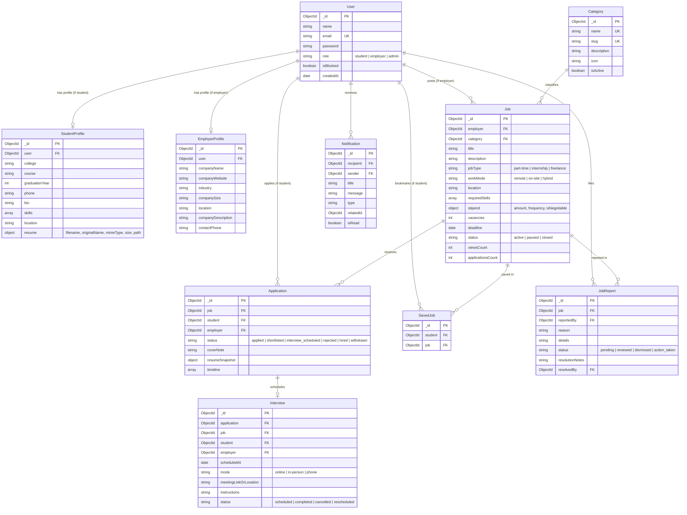

# PartTimeConnect – Architecture & Technical Specification
**Project Type:** MCA Mini Project  
**Technology Stack:** MERN (MongoDB, Express.js, React.js, Node.js)  
**Target Environment:** Windows 11 (PowerShell compatible)

---

## 1. Project Overview & Specification Analysis

**PartTimeConnect** is a full-featured, secure, multi-role web platform designed to bridge the gap between college students seeking flexible part-time employment/internships and employers seeking talent. It includes moderation tools for platform administrators.

### Core User Roles & Capabilities

| Role | Access Level | Key Capabilities |
|---|---|---|
| **Student** | Authenticated User | Profile management, college info, skills, private resume upload (PDF/DOC/DOCX), advanced job search with filters, rule-based job recommendations with match %, one-click application, application tracking, withdrawal, bookmarking/saved jobs, notifications, job reporting. |
| **Employer** | Authenticated User | Company profile management, job posting (create, edit, delete, pause/activate), view applicants, secure resume download with access control, update application statuses, shortlist/reject, schedule interviews, send notifications. |
| **Admin** | Moderation & System Admin | Platform analytics, user management (view, block/unblock students and employers), job moderation (delete fraudulent or inappropriate listings), category management, reported jobs resolution. Initial account seeded securely. |

---

## 2. System Architecture

PartTimeConnect adheres to a 3-tier decoupled architecture:
1. **Presentation Layer (Frontend):** React.js + Vite, React Router DOM, Context API for state management, Axios HTTP client with request/response interceptors, Lucide React icons, and a custom CSS design system.
2. **Application Layer (Backend):** Node.js + Express.js REST API with controller-service-repository patterns, JWT authentication, role-based authorization middleware, Multer file upload validation, rule-based recommendation engine, and centralized error handling.
3. **Data Layer (Database):** MongoDB with Mongoose ODM, utilizing compound unique indexes, validation constraints, and populated object references.

```
+-------------------------------------------------------------------------+
|                           CLIENT (React + Vite)                         |
|  - Public Pages (Home, Jobs, Details, About, Contact, Auth)             |
|  - Role Dashboards (Student, Employer, Admin)                           |
|  - Contexts: AuthContext, NotificationContext                           |
|  - Axios API Client with JWT Bearer Interceptors                        |
+------------------------------------+------------------------------------+
                                     |  HTTP / REST JSON
                                     v
+-------------------------------------------------------------------------+
|                        BACKEND API (Node.js + Express)                  |
|  - Security & Middleware: Helmet, CORS, Rate-Limit, Auth, RoleCheck     |
|  - Controllers: Auth, Users, Students, Employers, Jobs, Apps, Admin     |
|  - Services: RecommendationEngine, ResumeService, QueryFilterBuilder   |
|  - Private Uploads: Secure resume store (no static express directory)   |
+------------------------------------+------------------------------------+
                                     |  Mongoose ODM
                                     v
+-------------------------------------------------------------------------+
|                             DATABASE (MongoDB)                          |
|  - Users, StudentProfiles, EmployerProfiles, Jobs, Categories          |
|  - Applications, SavedJobs, Notifications, Interviews, JobReports       |
+-------------------------------------------------------------------------+
```

---

## 3. Complete Folder Structure

```
PartTimeConnect/
├── ARCHITECTURE.md
├── README.md
├── server/
│   ├── config/
│   │   └── db.js                 # MongoDB connection logic
│   ├── controllers/
│   │   ├── authController.js     # Register, login, me, logout
│   │   ├── studentController.js  # Profile, resume upload/download, saved jobs
│   │   ├── employerController.js # Profile, job management, applicant tracking
│   │   ├── jobController.js      # Public browse, search, filters, details
│   │   ├── applicationController.js # Apply, track, withdraw, status updates
│   │   ├── categoryController.js # CRUD for job categories
│   │   ├── notificationController.js # List, mark as read, delete
│   │   ├── interviewController.js # Schedule, update, cancel interviews
│   │   ├── reportController.js   # Report job, resolve reports
│   │   └── adminController.js    # System stats, manage users, moderate jobs
│   ├── middleware/
│   │   ├── authMiddleware.js     # JWT verification
│   │   ├── roleMiddleware.js     # Strict role check (Student/Employer/Admin)
│   │   ├── uploadMiddleware.js   # Multer resume validator (5MB, PDF/DOC/DOCX)
│   │   ├── errorMiddleware.js    # Centralized error handler & 404 handler
│   │   └── validateMiddleware.js # Request payload validation
│   ├── models/
│   │   ├── User.js
│   │   ├── StudentProfile.js
│   │   ├── EmployerProfile.js
│   │   ├── Category.js
│   │   ├── Job.js
│   │   ├── Application.js
│   │   ├── SavedJob.js
│   │   ├── Notification.js
│   │   ├── Interview.js
│   │   └── JobReport.js
│   ├── routes/
│   │   ├── authRoutes.js
│   │   ├── studentRoutes.js
│   │   ├── employerRoutes.js
│   │   ├── jobRoutes.js
│   │   ├── applicationRoutes.js
│   │   ├── categoryRoutes.js
│   │   ├── notificationRoutes.js
│   │   ├── interviewRoutes.js
│   │   ├── reportRoutes.js
│   │   └── adminRoutes.js
│   ├── services/
│   │   ├── recommendationService.js # Rule-based match algorithm
│   │   └── queryBuilder.js          # Search, filter, sort, paginate
│   ├── utils/
│   │   ├── tokenUtils.js         # JWT signing & verification
│   │   └── apiResponse.js        # Standardized { success, data, message }
│   ├── uploads/
│   │   └── resumes/              # Strictly private server directory
│   ├── scripts/
│   │   └── seed.js               # Admin, students, employers, 15+ jobs
│   ├── tests/
│   │   ├── auth.test.js
│   │   ├── jobs.test.js
│   │   ├── applications.test.js
│   │   ├── interviews.test.js
│   │   └── admin.test.js
│   ├── .env.example
│   ├── package.json
│   └── server.js                 # Entry point
│
└── client/
    ├── public/
    │   └── favicon.ico
    ├── src/
    │   ├── assets/
    │   ├── components/
    │   │   ├── common/           # Navbar, Footer, Sidebar, Loader, Modal, Badge
    │   │   ├── jobs/             # JobCard, SearchBar, FilterSidebar, JobDetail
    │   │   ├── student/          # ResumeUploader, SkillTagInput, AppTracker
    │   │   ├── employer/         # ApplicantTable, InterviewModal, JobForm
    │   │   └── admin/            # StatCard, UserTable, ReportTable
    │   ├── context/
    │   │   ├── AuthContext.jsx
    │   │   └── NotificationContext.jsx
    │   ├── hooks/
    │   │   ├── useAuth.js
    │   │   └── useDebounce.js
    │   ├── pages/
    │   │   ├── public/           # Home, Jobs, JobDetail, Login, Register, About, Contact
    │   │   ├── student/          # Dashboard, Profile, SavedJobs, Applications, Recommendations
    │   │   ├── employer/         # Dashboard, CompanyProfile, MyJobs, PostJob, EditJob, Applicants, Interviews
    │   │   └── admin/            # Dashboard, Users, JobsManagement, Categories, Reports
    │   ├── routes/
    │   │   ├── AppRoutes.jsx
    │   │   └── ProtectedRoute.jsx
    │   ├── services/
    │   │   ├── api.js            # Axios client with interceptors
    │   │   ├── authService.js
    │   │   ├── jobService.js
    │   │   └── studentService.js
    │   ├── styles/
    │   │   ├── index.css         # Design tokens, CSS variables, resets
    │   │   └── components.css    # Reusable UI styles
    │   ├── App.jsx
    │   └── main.jsx
    ├── index.html
    ├── vite.config.js
    └── package.json
```

---

## 4. Database Relationship Design (Mongoose Models)



### Key Integrity & Indexing Rules
1. **Application uniqueness:** Compound index `{ job: 1, student: 1 }` with `{ unique: true }` guarantees a student cannot apply twice for the same job.
2. **SavedJob uniqueness:** Compound index `{ student: 1, job: 1 }` with `{ unique: true }` prevents duplicate bookmarks.
3. **Job Search indexing:** Text or compound index on `{ title: 'text', description: 'text', requiredSkills: 'text' }` alongside indexes on `category`, `workMode`, `stipend.amount`, and `status`.

---

## 5. API Endpoint Plan

### 5.1 Authentication (`/api/auth`)
- `POST /register` – Register new user (Student or Employer only).
- `POST /login` – Authenticate user and return JWT + user object.
- `GET /me` – Retrieve current authenticated user profile.
- `POST /logout` – Invalidate/clear session client-side.

### 5.2 Students (`/api/students`)
- `GET /profile` – Get student profile.
- `PUT /profile` – Update student profile, college, skills, location.
- `POST /resume` – Upload/replace resume (Multer, 5MB max, PDF/DOC/DOCX).
- `GET /resume` – Secure download of student's own resume.
- `DELETE /resume` – Delete uploaded resume.
- `GET /recommendations` – Get rule-based matching jobs with % score breakdown.

### 5.3 Employers (`/api/employers`)
- `GET /profile` – Get employer profile.
- `PUT /profile` – Update company details.
- `GET /jobs` – List all jobs posted by the authenticated employer.
- `GET /jobs/:jobId/applicants` – List applicants for a specific job.
- `GET /applicants/:applicationId/resume` – Secure download of applicant resume.
- `PUT /applications/:applicationId/status` – Update status (shortlist, reject, hire).

### 5.4 Jobs (`/api/jobs`)
- `GET /` – Public search, filter (category, type, mode, stipend, location), sort, pagination.
- `GET /featured` – Top active jobs for homepage.
- `GET /:id` – Get full job details and increment view counter.
- `POST /` – Employer create job.
- `PUT /:id` – Employer edit job.
- `DELETE /:id` – Employer delete job.
- `PATCH /:id/status` – Employer pause/activate job.

### 5.5 Applications (`/api/applications`)
- `POST /` – Student apply for job (with resume snapshot & cover note).
- `GET /my` – Student view all their submitted applications with live status.
- `DELETE /:id/withdraw` – Student withdraw an active application.
- `GET /:id` – View single application detail with status timeline.

### 5.6 Saved Jobs (`/api/saved-jobs`)
- `GET /` – Student view saved/bookmarked jobs.
- `POST /:jobId` – Save a job.
- `DELETE /:jobId` – Remove a saved job.

### 5.7 Categories (`/api/categories`)
- `GET /` – List active job categories.
- `POST /` – Admin create category.
- `PUT /:id` – Admin update category.
- `DELETE /:id` – Admin deactivate/delete category.

### 5.8 Interviews (`/api/interviews`)
- `POST /` – Employer schedule interview for an application.
- `GET /my` – View interviews (Student sees their scheduled interviews, Employer sees theirs).
- `PATCH /:id` – Update or cancel interview.

### 5.9 Reports (`/api/reports`)
- `POST /` – Student report inappropriate job.
- `GET /` – Admin view all reported jobs with filter by status.
- `PATCH /:id` – Admin resolve report (dismiss or take action).

### 5.10 Notifications (`/api/notifications`)
- `GET /` – Get user notifications.
- `PATCH /:id/read` – Mark notification as read.
- `PATCH /read-all` – Mark all notifications as read.

### 5.11 Admin (`/api/admin`)
- `GET /stats` – Platform analytics (total users, jobs, applications, active listings).
- `GET /users` – List all users with pagination and role filter.
- `PATCH /users/:id/block` – Block/unblock user.
- `GET /jobs` – List all jobs with moderation controls.
- `DELETE /jobs/:id` – Remove fraudulent/inappropriate job.

---

## 6. Recommendation System Engine Design (Free, Rule-Based)

Calculated on the backend without third-party or paid AI APIs:
$$\text{Match Score} = W_{\text{skills}} \times S_{\text{skills}} + W_{\text{category}} \times S_{\text{cat}} + W_{\text{mode}} \times S_{\text{mode}} + W_{\text{location}} \times S_{\text{loc}}$$

- **Skills Match (Weight: 50%):** Jaccard/overlap score between `StudentProfile.skills` and `Job.requiredSkills`.
- **Category Match (Weight: 20%):** Does job category match student preferences or course affinity.
- **Work Mode Match (Weight: 15%):** Remote jobs match 100%; On-site matches if student location matches job city.
- **Location Match (Weight: 15%):** Exact city match or state match.
- **Output:** Returns match percentage (0–100%), matching skills array, missing skills array, and descriptive explanation badge.

---

## 7. Resume Security & Storage Design

1. Stored in `server/uploads/resumes/` — this directory is **never** served statically via `express.static()`.
2. Multer storage generates random cryptographically secure filenames: `<uuid>-<timestamp>.<ext>`.
3. Validation verifies MIME type (`application/pdf`, `application/msword`, `application/vnd.openxmlformats-officedocument.wordprocessingml.document`) and file size ($\le 5\text{ MB}$).
4. Download endpoints enforce authorization:
   - Students can only download their own resume.
   - Employers can only download resumes of students who applied to their specific jobs.
   - Admin can view resumes for dispute resolution.

---

## 8. Potential Technical Risks & Mitigations

| Risk | Description | Mitigation |
|---|---|---|
| **MongoDB Service on Windows** | MongoDB local service may not be running or may be in Atlas cloud mode. | Provide clear configuration for local MongoDB (`mongodb://127.0.0.1:27017/parttimeconnect`) and Atlas URI in `.env.example`. Test connectivity before boot. |
| **Resume Directory Traversal** | Malicious filename upload or path manipulation. | Use generated sanitized UUID filenames and `path.basename()` verification. |
| **Duplicate Applications** | Double-clicking or network retries causing duplicate DB entries. | Compound unique index `{ job: 1, student: 1 }` at MongoDB schema level, plus programmatic check. |
| **Orphaned Uploads** | Unused resumes consuming disk space when replaced. | Clean up old resume file using `fs.unlink()` when student replaces or deletes resume. |
| **CORS / Port Mismatch** | Vite runs on port 5173, Express on 5000. | Pre-configured CORS middleware with credentials support and Vite dev proxy. |
